<!-- ───────────────────────────── HEADER ───────────────────────────── -->
<p align="center">
  
</p>

<p align="center">
  <a href="https://git.io/typing-svg">
    
  </a>
</p>

<p align="center">
  <a href="https://portofoliov2-rho.vercel.app"></a>
  <a href="https://www.linkedin.com/in/rania-sellak-00a60932b/"></a>
  <a href="https://gitlab.com/r.sellak5334"></a>
  
</p>

---

### `> cat about.txt`

```yaml
name:      Rania Sellak
role:      Engineering student, Information Systems Security (SIT3) @ FST Marrakech
focus:     [web application security, penetration testing, DevSecOps, AI x cybersecurity]
mindset:   "Think like an attacker, build like a defender."
currently:
  - working through PortSwigger Web Security Academy labs (auth, access control, XSS)
  - auditing apps against OWASP ASVS 5.0
  - building an AI-assisted DevSecOps pipeline (SAST, SCA, DAST, risk scoring)
also_build: full-stack apps (Laravel, Spring Boot, Angular, React, FastAPI)
languages: [Arabic, French, English]
```

### `> ls ./focus-areas`

<table>
  <tr>
    <td width="50%" valign="top">
      <h4>🕷️ Web Application Pentest</h4>
      Recon, HTTP traffic analysis, and exploitation of OWASP Top 10 classes: broken authentication, broken access control / IDOR, XSS, LFI / path traversal, OS command injection, SQLi.
    </td>
    <td width="50%" valign="top">
      <h4>🛡️ Secure Design & Verification</h4>
      Auditing applications against <b>OWASP ASVS 5.0</b>, threat modelling, risk & control matrices, and writing remediation guidance developers can act on.
    </td>
  </tr>
  <tr>
    <td width="50%" valign="top">
      <h4>⚙️ DevSecOps</h4>
      Security gates in CI/CD: SAST (Bandit, Semgrep), dependency scanning (pip-audit, Safety), DAST (OWASP ZAP), and builds that fail on critical findings.
    </td>
    <td width="50%" valign="top">
      <h4>🤖 AI × Security</h4>
      Machine-learning intrusion detection (CAN-bus IDS), fraud scoring, and AI-assisted triage of scanner output.
    </td>
  </tr>
</table>

### `> ./arsenal --list`

**Offensive and analysis**

<p>
  
  
  
  
  
  
  
  
  
  
</p>

**DevSecOps**

<p>
  
  
  
  
  
  
</p>

**Build**

<p>
  <a href="https://skillicons.dev"></a>
</p>

---

### `> ls ./projects --featured`

| Project | What it is | Security angle |
|:--|:--|:--|
| 🛡️ **[AI-Powered DevSecOps Pipeline](https://github.com/raniasellak/AI-Powered-DevSecOps-Pipeline-for-Python)** | InvoicePay: a FastAPI invoicing and payment platform designed around a security-gated CI/CD pipeline | Argon2id, short-lived JWT, rotating refresh tokens with reuse detection, RBAC; SAST, SCA, DAST and AI risk scoring on the roadmap |
| 🚗 **[CAN-Bus Intrusion Detection](https://github.com/raniasellak/can-bus-intrusion-detection)** | ML IDS for automotive CAN networks (DoS, brake and steering tampering) | Data-leakage diagnosis, temporal split, class rebalancing, precision/recall/FPR |
| 🧪 **[Web Security Labs](https://github.com/raniasellak/web-security-labs)** | Write-ups: auth bypass, BAC/IDOR, XSS, LFI, command injection, HTTP analysis | Burp Suite, DVWA, Metasploitable 2, OWASP ASVS V6 |
| 🎮 **[Cyber Quiz Game](https://github.com/raniasellak/cyber_game_reactapp)** · [live](https://raniasellak.github.io/cyber_game_reactapp/) | Awareness game: explain 20 real-world attacks, with progressive hints and defence tips | Security awareness (phishing, MITM, XSS, session hijacking…) |
| 🔐 **[PHP User Management](https://github.com/raniasellak/interface-de-gestion-des-utilisateur-en-php-native)** | Native PHP auth: roles, admin panel, password reset | Prepared statements, bcrypt, output encoding, CSPRNG reset tokens |
| 🛒 **[E-commerce Platform](https://github.com/raniasellak/Projet-de-stage-plateforme-e-commerce)** | Internship project: Spring Boot and Angular store with PayPal and reservations | Spring Security, payment flow, hardening roadmap |

<details>
<summary><b>More projects</b></summary>
<br/>

| Project | Stack |
|:--|:--|
| [CSC Club Platform v3](https://github.com/raniasellak/cscv3): members, events, training, shop, certificates, chatbot | Laravel 12 |
| [CSC Club Platform v1](https://github.com/raniasellak/csc) | Laravel 12 |
| [Quiz IT · CSC](https://github.com/raniasellak/quiz-it-csc) | HTML, CSS, JS |
| [Bank Marketing Classification](https://github.com/raniasellak/les-algorithmes-de-classificaion-sur-data-bank-): KNN, SVM, DT, RF, Perceptron | Python, scikit-learn |
| [Laravel CRUD with Authentication](https://github.com/raniasellak/creation-avec-application-CRUD-avec-athentification) | Laravel 12, Breeze |
| [Product Catalogue CRUD](https://github.com/raniasellak/Cr-ation-d-une-application-Catalogue-de-Produits-par-un-syst-me-CRUD) | Laravel 12 |
| [Nutrition Mobile App](https://github.com/raniasellak/projet-application-mobile-nutritionapp) | Android, Java, SQLite |
| [FST Marrakech Website](https://github.com/raniasellak/fstg-website) | HTML, CSS |
| [ROYAH](https://github.com/raniasellak/royahe) | HTML, CSS, JS |
| [Portfolio](https://github.com/raniasellak/portofolio_v2) · [live](https://portofoliov2-rho.vercel.app) | HTML, CSS, JS |

</details>

---

### `> ./lab-log --owasp`

```diff
+ A01  Broken Access Control   admin panel privesc · IDOR on ?id=
+ A01  Path Traversal / LFI    ?page=../../../../etc/passwd
+ A03  Injection               reflected + stored XSS · OS command injection
+ A04  Insecure File Upload    PHP web shell → reverse shell
+ A07  Authentication          user enumeration · 2FA bypass · reset logic
+ ---  HTTP                    GET · conditional GET (304) · persistent conn.
! Lab targets only: PortSwigger Academy · DVWA · Metasploitable 2
```

### `> ./stats`

<p align="center">
  
  
</p>

<p align="center">
  
</p>

---

### `> cat disclaimer.txt`

> Every offensive technique shown on this profile was practised in **authorised, isolated lab environments** for learning. I follow responsible disclosure. If you find a vulnerability in one of my projects, please open a private security advisory or contact me on LinkedIn.

<p align="center">
  
</p>


